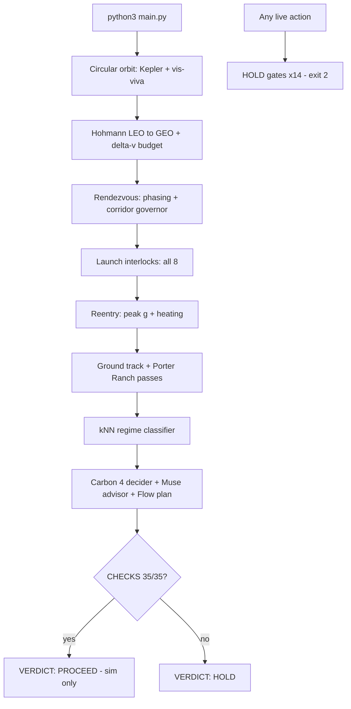
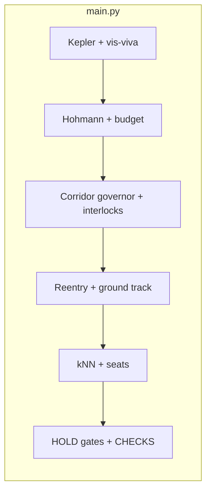
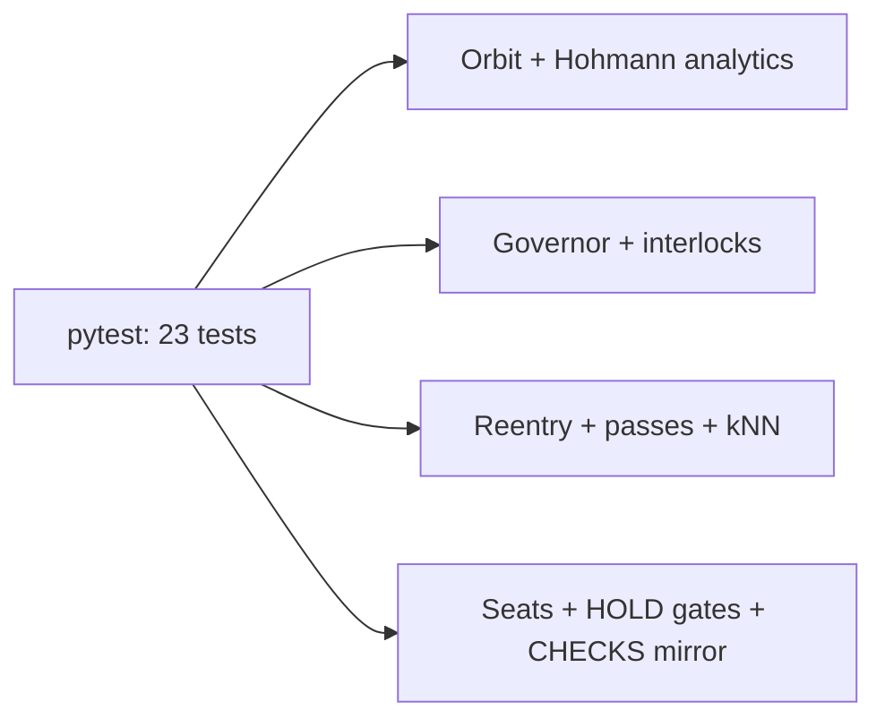
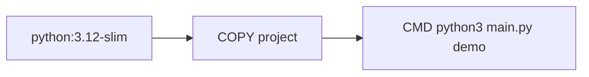

# 🛰️ OrbitX — Orbital Transport Autopilot Lab

> **A SIM-ONLY orbital transport autopilot lab in pure Python stdlib: Kepler circular orbits, a computed LEO→GEO Hohmann transfer, a delta-v budget, a docking-corridor governor, launch interlocks, reentry physics, and ground-station pass prediction — with 14 HOLD gates. Nothing here launches or flies anything real.**
>
> 👨‍💻 By Darion Kellar · 📜 MIT License · 🐍 Pure stdlib · 🌐 Zero network

---

## ❓ What is this about?

OrbitX **completes the X transportation family**:

| Member | World |
|---|---|
| ✈️ Flightx | Air |
| 🛥️ YachtX | Water |
| 🚐 RVx | Road |
| 🛸 HoverX | Low altitude |
| 🌀 TeleportX | Teleport |
| 🛰️ **OrbitX** | **Space — the final environment** |

It is a working orbital-mechanics lab for an uncrewed cargo transport craft, built the way a flight-dynamics engineer would sanity-check a mission on paper: How fast is a 400 km orbit, really? What does a Hohmann transfer to GEO cost in delta-v and time? How slow must an approach be at 50 metres from a station? What must be true before launch is even allowed — in simulation? What does reentry do to the vehicle, and when will the craft pass over home?

Every answer is computed from real formulas — Kepler, vis-viva, Allen–Eggers, Sutton–Graves — and asserted in CHECKS against analytic values. And because real spaceflight is unforgiving, the lab is strict about its boundary: **simulation only, forever**. Live launch, real spacecraft control, live docking, disabling the abort system and 10 more live actions sit behind HOLD gates that nothing in the code — including the AI seats — can lift.

---

## 🛠️ Tech Stack & Full Architecture

### 💻 Core Language & Runtime

-brightgreen)


### 🧮 Physics & Orbital Mechanics


### 🧠 Advisory Seats (names-only, never override a HOLD)


-34A853)

### 🐳 Container & CI


> ⚠️ Workflow badges are static **Pending Paste** shields on purpose: `ci.yml` and `docker-publish.yml` are delivered in the workflow paste pack and have not been pasted into `.github/workflows/` yet, so no live badge exists to show. The Docker image tag they will publish is `credkellar/orbitx:latest`.

### 🧪 Testing


### 🌐 Web3 & Cloud
None — honestly none. OrbitX runs fully offline in one file; there is no chain, no cloud call, and no account involved.

### 🏗️ Architecture in one line
ONE `main.py` holds the orbit mechanics, transfer planner, corridor governor, interlocks, reentry model, ground-track propagator, classifier and seats — so the whole mission can be read, run and audited in one sitting.

---

## ⚙️ What this does — step by step

1. 🌍 **Builds circular orbits** — velocity √(μ/r) and Kepler period 2π√(r³/μ): 400 km → 7,673 m/s, 92.4 min; GEO period lands on the sidereal day.
2. 🔀 **Plans the Hohmann transfer** — LEO→GEO: Δv₁ 2,399 + Δv₂ 1,457 = **3,857 m/s**, transfer time 5.29 h, all from vis-viva.
3. ⛽ **Tables the delta-v budget** — launch-to-LEO 9,400 m/s and other standard reference values, clearly labelled reference vs computed.
4. 🎯 **Flies the rendezvous — on paper** — phasing estimate plus a docking-corridor governor: 5.0 m/s far-field shrinking to 0.05 m/s at capture; requests above a cap are clamped, never granted.
5. ✅ **Checks launch interlocks** — propellant ≥ 90%, comms, tracking, weather, range clear, abort armed, thermal, crew-systems (uncrewed cargo: cabin stowed + safed). ALL 8 must pass.
6. 🔥 **Simulates reentry** — Allen–Eggers peak deceleration (4.1 g for a shallow capsule entry) and Sutton–Graves stagnation heating (∝ v³), plus a landing ellipse.
7. 📡 **Propagates the ground track** — circular orbit, spherical Earth, **J2 ignored (stated)**: max latitude = inclination, and **4 passes ≥ 10° over Porter Ranch in 24 h**.
8. 🧠 **Classifies the regime** — a stdlib kNN labels conditions go / marginal / no-go from upper wind, propellant and comms margin (100% self-accuracy on its training set).
9. 🪑 **Consults the seats** — Carbon 4 decides (tighten-only, sha256 trace), Muse advises (can_override_hold = False), Flow plans 5 shots (rendered = False, live = 0).
10. 🛑 **Runs CHECKS** — 35 assertions against analytic values, then prints the VERDICT.

---

## 📊 How this works — mermaid per script

### 🗺️ Master flow



### 📜 main.py — the whole lab



### 🧪 tests/test_main.py — proof, not promises



### 🐳 Dockerfile — the container



---

## 😎 Why is this cool?

1. 🛰️ It **completes the X family** — air, water, road, hover, teleport, and now space.
2. 🧮 The Hohmann transfer is **computed, not quoted** — vis-viva gives both burns and the 5.29 h coast.
3. 🌍 GEO's period falls out of Kepler and **lands on the sidereal day** — the math checks itself.
4. 🎯 The docking governor shrinks speed caps as range closes, exactly like real approach rules.
5. 🔥 Reentry heating scales as **v³** — double the speed, eight times the heat, proven in CHECKS.
6. 📡 It predicts **real passes over Porter Ranch** from a propagator written from scratch.
7. ⛽ Reference and computed delta-v are **labelled separately** — no borrowed numbers dressed up as results.
8. 🛑 The abort system **cannot be disabled** — that gate is permanent, by design.
9. 🐍 Zero dependencies: the whole mission fits in one stdlib file you can audit in one sitting.
10. 🎓 It teaches orbital mechanics by *running* it — every formula is executable and tested.

---

## 🧩 What problems this solves

1. **Problem:** Textbook orbital mechanics feels abstract. → **Solution:** Every formula runs, with numbers asserted against analytic values.
2. **Problem:** Delta-v budgets get hand-waved. → **Solution:** A labelled budget table with the Hohmann row computed live.
3. **Problem:** Docking speeds are a mystery until they aren't. → **Solution:** A corridor governor with range-based caps you can clamp against.
4. **Problem:** Launch checklists look like bureaucracy. → **Solution:** 8 interlocks, each shown tripping on its own failure case.
5. **Problem:** Reentry danger is hard to feel from prose. → **Solution:** Peak-g and v³ heating curves from Allen–Eggers and Sutton–Graves.
6. **Problem:** "When is it overhead?" needs expensive tools. → **Solution:** A from-scratch propagator + elevation geometry answers it for Porter Ranch.
7. **Problem:** Simplifications get hidden in sims. → **Solution:** J2-ignored and spherical-Earth are stated in the open, in code and docs.
8. **Problem:** Go/no-go calls feel arbitrary. → **Solution:** A kNN classifier makes the regime call from weather, propellant and comms — transparently.
9. **Problem:** AI advisors get oversold as authorities. → **Solution:** Carbon 4 can only tighten to HOLD; Muse can never override one.
10. **Problem:** Space software demos drift toward real control. → **Solution:** 14 permanent HOLD gates keep every live action out, forever.

---

## 📥 How to install — step by step

1. 🐍 Install Python 3.12 (or any Python 3.10+).
2. 📂 Clone or download this repo.
3. ▶️ Run the lab: `python3 main.py`
4. 🧪 Run the tests: `pip install pytest` then `pytest -q`
5. 🔍 Explore: `python3 main.py hohmann`, `python3 main.py rendezvous`, `python3 main.py reentry`, `python3 main.py passes`
6. 🛑 See the boundary: `python3 main.py hold-demo` → HOLD, exit 2.
7. 🐳 Or run it in Docker: `docker build -t orbitx .` then `docker run --rm orbitx`

## 📋 Requirements

- Python 3.10+ (stdlib only — no pip installs needed to run the lab)
- pytest (only for the test suite)
- Docker (optional, for the container route)
- No network, no accounts, no API keys

---

## 🧒 Explain it in 5th-grade English

Imagine throwing a ball so fast sideways that as it falls toward Earth, the Earth curves away under it at the same speed. It keeps falling — but it never lands. That's an orbit. OrbitX is a practice spaceship that lives entirely inside your computer. It does the math for how fast the ship must go, how much fuel-energy it needs to climb to a higher orbit, how slowly it must creep up to a space station so it doesn't crash, and how hot and squished it gets when it comes back down through the air. It can even tell you when the ship will fly over Porter Ranch. It will never, ever touch a real spaceship — the doors to real launches are locked with 14 locks, and nobody has the keys.

---

## 🌳 Full file tree

```
OrbitX/
├── main.py                  # 🛰️ the whole lab: orbits, transfers, governor, interlocks, reentry, passes, seats, HOLD gates, CHECKS
├── tests/
│   └── test_main.py         # 🧪 23 pytest tests mirroring the CHECKS
├── conftest.py              # 🧪 root path fix for bare pytest
├── README.md                # 📖 this file
├── Dockerfile               # 🐳 python:3.12-slim container
├── assets/
│   └── cover.png            # 🎨 cover art (2736×912)
└── .gitignore               # 🙈 pycache / pytest cache
```
